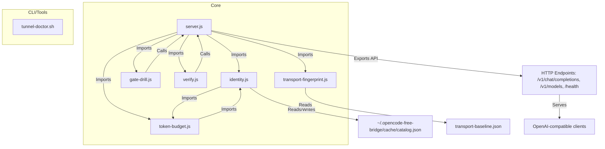

# opencode-free-bridge Code Graph

This document provides a persistent, high-level structural map of the `opencode-free-bridge` codebase for AI agents and developers to understand the project architecture instantly, avoid architectural anti-patterns, and drastically reduce file-reading overhead.

---

## A. Visual Architecture

### Mermaid.js Diagram



### ASCII Architecture

```
┌───────────────────┐         ┌───────────────────┐
│   server.js       │◄───────►│   identity.js     │
├───────────────────┤    │    ├───────────────────┤
│ - Main HTTP API   │    │    │ - Syncs identity  │
│ - Self-update     │    │    │ - Catalog cache   │
│ - Loads token     │    │    │ - Model facts     │
│   budgeting       │    │    └───────────────────┘
└───────────────────┘    │           │
        │                │           │
        │                ▼           │
┌───────────────────┐  ┌───────────────────┐
│ token-budget.js   │◄─┤  gate-drill.js    │
├───────────────────┤  ├───────────────────┤
│ - Token logic     │  │ - Gate healing    │
└───────────────────┘  └───────────────────┘
        │
        │
┌───────────────────┐
│ verify.js         │
├───────────────────┤
│ - Health check    │
└───────────────────┘
        │
        │
┌───────────────────┐
│ transport-        │
│ fingerprint.js    │
├───────────────────┤
│ - TLS parity      │
└───────────────────┘
        │
        │
┌───────────────────┐
│ tunnel-doctor.sh  │
├───────────────────┤
│ - SSH tunnel      │
│   audit/cleanup   │
└───────────────────┘
```

---

## B. Structured Code Graph Index

### [server.js]
- **Role:** Main HTTP server that provides OpenAI-compatible API, orchestrates self-update, manages session affinity, and coordinates endpoint wiring.
- **Exports:** HTTP server (default entry point), API endpoints (`/v1/chat/completions`, `/v1/models`, `/health`).
- **Dependencies:** `identity.js`, `token-budget.js`, built-in modules (`http`, `crypto`, `dns`, `fs`, `path`).
- **Incoming References:** CLI (`bun server.js`), test suite (`test/server.test.js`), `install.sh`, `gate-drill.js`, `verify.js`.
- **Key Functions/Logic:**
  - `isNewerVersion(current, remote)` -> Semantic version comparison for self-update.
  - `checkAndApplyUpdate()` -> Polls GitHub for new releases, downloads and validates files, performs atomic swap, and exits for service restart.
  - **HTTP Endpoints:**
    - `POST /v1/chat/completions` – OpenAI-compatible chat completions with SSE streaming, tool call de-collision (`read` → `read_client`), and reasoning content extraction.
    - `GET /v1/models` – Returns active free models derived from upstream catalog.
    - `GET /health` – Health status, derived identity, gate state, and version information.
  - **Gate Retry Logic:** On `403 FreeTierError` / `426 UpgradeRequired` / `404`, refreshes identity, evicts stale sessions, mints fresh session ID, escalates to full tool profile, and retries once. Suppresses redundant retries within 30s cooldown (`GATE_RETRY_COOLDOWN_MS`) to avoid amplifying IP penalties.
  - **Session Affinity:** Caches session IDs per model with TTL, evicts on gate errors.

### [identity.js]
- **Role:** Adaptive synchronization of OpenCode CLI identity: version handshake, session ID recipe, tool/plugin schema extraction, and provider catalog management.
- **Exports:** `getModelFacts(modelId)`, `getSessionId(modelId)`, `getCatalog()`, identity state, cache management functions.
- **Dependencies:** `crypto`, `fs`, `path`, `os`, built-in `http`/`https` (via `fetch`).
- **Incoming References:** `server.js`, `token-budget.js`.
- **Key Functions/Logic:**
  - **Update Modes:**
    - `reactive` (default): Uses current identity until upstream rejects (`403`/`426`), then refreshes.
    - `always`: Proactively adopts every new OpenCode release when TTL expires.
  - `getUpdateMode()` -> Determines sync strategy from `UPDATE_MODE` env var.
  - `getCatalogCacheDir/File()` -> Resolves cache paths (`~/.opencode-free-bridge/cache/catalog.json`).
  - **Identity Sync Pipeline:**
    1. Handshake with `https://opencode.ai/update/api/<channel>/<artifact>/<distribution>` to get latest version and commit SHA.
    2. Fetch source files from GitHub at exact commit: `identifier.ts`, `session-id.ts`, `app.ts`, `model-request.ts`, and all plugin files from `packages/core/src/tool/plugin/`.
    3. Parse Effect Schema AST to extract tool fingerprints (name, description, input schema).
    4. Fetch and cache provider catalog from `https://models.opencode.ai/api.json`.
  - **Catalog Management:**
    - Derives active free models (`cost.input === 0`).
    - Resolves family aliases (`mimo` → `mimo-v2.6-flash-free`).
    - Exposes model facts (reasoning flag, output ceiling, cost).
  - **Session ID Generation:** Pooled CSPRNG-based generator following derived recipe (`ses_` + 12 hex + 14 base62).
  - **Gate Anchors:** Pins required tool names (`read`, `shell`, etc.) and header names independently of derived recipe to audit shape bugs vs IP blocks.

### [token-budget.js]
- **Role:** Computes effective token budgets for reasoning and non-reasoning models, preventing silent truncation of chain-of-thought tokens.
- **Exports:** `effectiveMaxTokens(requested, modelId, body)`, `isReasoningModel(modelId)`, `isReasoningRequest(body, modelId)`, constants.
- **Dependencies:** `identity.js` (for model facts).
- **Incoming References:** `server.js`.
- **Key Functions/Logic:**
  - `isReasoningModel(modelId)` -> Checks catalog's `reasoning: true` flag.
  - `isReasoningRequest(body, modelId)` -> True if model is reasoning or client requested `reasoning_effort`.
  - `effectiveMaxTokens(requested, modelId, body)` -> Applies additive budget formula:
    - **Reasoning models:** `max(requested, 1024) + 4096` (thinking headroom).
    - **Standard models:** `max(requested, 512)` (floor to prevent mid-sentence truncation).
    - Caps at model's `limit.output` from catalog.
  - **Constants:**
    - `MIN_ANSWER_TOKENS = 1024`
    - `THINKING_BUDGET = 4096`
    - `MAX_OUTPUT_TOKENS = 131072`
    - `MIN_PLAIN_TOKENS = 512`

### [gate-drill.js]
- **Role:** End-to-end self-healing drills against real upstream gate (not a unit test). Deliberately starts bridge in rejected states and verifies reactive recovery.
- **Exports:** CLI script.
- **Dependencies:** `http`, invokes running `server.js`.
- **Incoming References:** CLI (`bun gate-drill.js`), CI verification.
- **Key Functions/Logic:**
  - `ask(port, body)` -> Sends test requests to bridge with forced `stream: true`.
  - **Drills (10 total):** `version-floor`, `legacy-shape`, `empty-tools`, `session-shape`, `endpoint-move`, `routing`, `allowlist`, `retry-endpoint`, `gate-heal`, `full-corrupt`.
  - **Exit Codes:** 0 = all drills passed, 1 = one or more failed.

### [verify.js]
- **Role:** Self-check script for bridge health and model readiness. Answers "does this actually work?"
- **Exports:** CLI script.
- **Dependencies:** `http`, calls running `server.js`.
- **Incoming References:** CLI (`bun verify.js` / `bun verify.js --quick`), `install.sh` post-install check.
- **Key Functions/Logic:**
  - `assembleSse(raw)` -> Folds SSE stream into single Chat Completions object.
  - `request(method, path, body, timeoutMs)` -> Sends test requests with configurable timeout.
  - **Exit Codes:** 0 = at least one model answered, 1 = all failed, 2 = gate closed (IP throttled).

### [transport-fingerprint.js]
- **Role:** Captures and compares runtime's TLS ClientHello fingerprint to ensure Bun parity with OpenCode CLI.
- **Exports:** CLI script.
- **Dependencies:** `net`, `fs`, `path`.
- **Incoming References:** CLI (`bun transport-fingerprint.js --check`), `install.sh` verification.
- **Key Functions/Logic:**
  - `parseClientHello(buf)` -> Raw TLS handshake parser extracting cipher suites and extension order.
  - `capture()` -> Opens TCP listener, points `fetch` at it, captures ClientHello bytes.
  - **CLI Modes:** Default (print), `--check` (compare vs baseline), `--write-baseline` (update baseline).

### [tunnel-doctor.sh]
- **Role:** Audits and reaps stale SSH reverse port forwards, checks keepalive settings.
- **Exports:** Bash script.
- **Dependencies:** `ss`, `ps`, `sed`, `bash`.
- **Incoming References:** Manual operator use for multi-VPS deployments.
- **Key Functions/Logic:**
  - Detects stale forwards by checking for established TCP transport.
  - **CLI Modes:** Report only (default), `--reap` (kill stale sessions), `--check` (audit keepalive).
  - Scans ports 20120-20149 by default.

### [install.sh]
- **Role:** Zero-dead-end universal installer for Linux (systemd) and macOS (launchd).
- **Exports:** Bash installer script.
- **Dependencies:** `curl`, `bash`, `bun` (installs if missing), `unzip` (installs if missing).
- **Key Functions/Logic:**
  - Finds or installs Bun, downloads all files, validates syntax, checks port availability.
  - Retires legacy services, backs up previous install, registers service, verifies health.
  - **Environment Variables:** `PORT`, `HOST`, `BINDIR`, `NO_SERVICE`.

### [test/*.test.js]
- **Role:** Comprehensive unit and integration test suite (9 files, 144KB).
- **Exports:** Test cases for Bun test runner.
- **Dependencies:** Bun test runner, all core modules.
- **Test Files:** `gate-contract`, `identity`, `install-migration`, `no-hardcoded-models`, `optimizations`, `server`, `token-budget`, `transport-fingerprint`, `verify-quick`.

### [Dockerfile]
- **Role:** Production-ready container image definition using Bun runtime on Alpine Linux.
- **Exports:** Docker image specification.
- **Dependencies:** `oven/bun:1.1.38-alpine` base image, `curl`, `ca-certificates`.
- **Key Features:**
  - Non-root user (`bridge`, UID 1001) for security.
  - Multi-stage capable for optimized builds.
  - Built-in health check via `/health` endpoint.
  - Cache directory volume mount at `/app/.cache`.
  - All environment variables supported (PORT, HOST, UPDATE_MODE, etc.).

### [docker-compose.yml]
- **Role:** Declarative multi-container orchestration configuration.
- **Exports:** Docker Compose service definitions.
- **Key Features:**
  - Single-command deployment (`docker-compose up -d`).
  - Automatic restart policy (`unless-stopped`).
  - Resource limits (CPU: 1.0, Memory: 512M).
  - Volume persistence for catalog cache.
  - Health check integration.
  - Commented multi-instance setup for load distribution.

### [.dockerignore]
- **Role:** Reduces Docker build context size by excluding unnecessary files.
- **Excludes:** Git files, documentation, tests, cache, logs, OS files, development artifacts.

### [DOCKER.md]
- **Role:** Comprehensive Docker deployment documentation (323 lines, 6.7KB).
- **Sections:** Quick start, configuration, multi-host setup, verification, production deployment, troubleshooting, security, monitoring, FAQ.
- **Key Topics:**
  - Docker Compose vs Docker CLI workflows.
  - Environment variable reference.
  - Multi-host rate-limit bypass strategies.
  - Nginx reverse proxy example.
  - Container verification commands.
  - Production best practices.

---

## C. Data Flow Patterns & Architectural Invariants

### Primary Multi-Step Flows

#### 1. Identity Sync & Gate Healing (Reactive Self-Healing)
```
Client Request → Server /v1/chat/completions
    ↓
Construct upstream request with:
  - Session ID (from identity.js pool)
  - Tool profile (from identity.js)
  - Token budget (from token-budget.js)
    ↓
Send to upstream (always stream: true)
    ↓
Upstream 403/426/404? → YES → Gate error detected
    ↓
Check cooldown (30s) → If outside cooldown:
  - Refresh identity from upstream API + GitHub
  - Evict stale session IDs
  - Mint fresh session ID
  - Escalate to full tool profile
  - Audit anchors (tools + headers)
    ↓
Retry once with refreshed identity
    ↓
Still 403 with full shape? → Egress IP refused
    ↓
NO → Success → Fold SSE to JSON if needed → Return to client
```

#### 2. Token Budget Calculation
```
Client request with max_tokens: N
    ↓
token-budget.js receives (N, modelId, body)
    ↓
Query identity.js for model facts
    ↓
Is reasoning model? (catalog.reasoning === true)
    ↓
YES: effective = max(N, 1024) + 4096
NO: effective = max(N, 512)
    ↓
Cap at model's limit.output from catalog
    ↓
Return effective budget to server.js
```

#### 3. Self-Update Pipeline
```
Server startup or 6h elapsed
    ↓
checkAndApplyUpdate() runs in background
    ↓
Fetch package.json from GitHub
    ↓
Compare versions → Is newer?
    ↓
YES → Download all files → Validate syntax
    ↓
All valid? → Rename into place atomically → Exit process
    ↓
Service manager restarts bridge
```

### Architectural Invariants & Constraints

1. **Runtime Constraint:** Must run under Bun. Node.js blocked for live traffic.
2. **Zero Dependencies:** Only built-in runtime modules.
3. **Model List Derivation:** Never hardcoded, always from upstream catalog.
4. **Token Budget:** Always additive for reasoning models.
5. **TLS Parity:** ClientHello must match OpenCode CLI (17 ciphers, 12 extensions).
6. **Streaming Requirement:** Upstream always receives `stream: true`.
7. **Atomic Updates:** Validates all files before swapping any.
8. **Gate Anchors:** Tool/header names pinned independently of derived recipe.
9. **IP Cooldown Protection:** 30s suppression of redundant retries.
10. **Session Affinity:** Session IDs cached per model with TTL.

---

## D. Gotchas & Pitfalls

### Critical "Never Do This" Rules

1. **Never run production server with Node.js.** `node server.js` exits immediately. Node's TLS fingerprint is rejected upstream. Use `bun server.js` exclusively.

2. **Never hardcode model IDs or aliases.** Model availability changes frequently. Retired: `cat-jam-free`, `muse-spark-*`, `step-5-preview-free`. Always query `/v1/models`.

3. **Never add external dependencies.** The bridge is zero-dependency by design. Do not run `npm install`.

4. **Never send non-streaming requests upstream.** Upstream rejects `stream: false` with `403 FreeTierError`. Server forces `stream: true` upstream.

5. **Never assume all `403` errors are IP bans.** `403 FreeTierError` has four causes: refused IP, missing tool anchor, invalid User-Agent, missing session header. Always audit anchors first.

### Fragile Code Areas

1. **TLS Fingerprint Drift:** Bun version upgrades may change ClientHello. Always run `bun transport-fingerprint.js --check` before deploying new Bun version.

2. **Catalog Sync Timing:** First request may hit before catalog fetch completes. Cached catalog prevents this. Never delete cache directory in production.

3. **Self-Update Atomicity:** Files swapped individually with `rename()`. Interrupted update (kill -9) may leave partial install. Pre-validation prevents syntax-broken files.

4. **Session ID Recipe Staleness:** Stale recipe mints wrong shape → `403`. Must re-mint after identity refresh, not just retry.

5. **Tool Profile Fallback:** Empty tool profile (`[]`) → `403`. Must have `read` tool minimum. Shipped fingerprint is fallback.

### Integration & Deployment Traps

1. **Port Conflicts:** Default 20129 may collide with legacy `opencode-bridge.service`. Installer retires old service.

2. **PATH Issues with Bun:** `bun.sh/install` only edits interactive shell. Systemd service must use absolute path (`~/.bun/bin/bun`).

3. **Git Checkout vs Install:** Self-update disabled if `.git` exists. Dev checkouts must pull manually.

4. **SSH Tunnel Stale Forwards:** Reverse tunnel listener persists 10 min after disconnect. Use `tunnel-doctor.sh --reap` or tighten keepalive.

5. **Multiple Bridge Instances:** Session affinity per instance (not shared). Load balancer must use sticky sessions.

---

## E. Testing Commands & Execution Workflows

### Unit & Integration Tests

```bash
# Run all tests (Bun)
bun test test/*.test.js

# Run all tests (Node, offline only)
ALLOW_NODE=1 node --test test/*.test.js

# Run specific test file
bun test test/server.test.js
bun test test/identity.test.js

# Run tests matching a pattern
bun test test/server.test.js --filter "gate healing"
```

### Gate & Transport Verification

```bash
# Run all gate drills (against live upstream)
bun gate-drill.js

# Run specific drill
bun gate-drill.js full-corrupt
bun gate-drill.js session-shape

# Verify bridge health (quick mode, 25s timeout)
bun verify.js --quick

# Verify bridge health (full mode, 120s timeout per model)
bun verify.js

# Check TLS fingerprint parity
bun transport-fingerprint.js --check

# Print current TLS fingerprint
bun transport-fingerprint.js

# Update baseline (after Bun upgrade)
bun transport-fingerprint.js --write-baseline
```

### Pre-flight Verification

```bash
# Check health endpoint
curl -s http://127.0.0.1:20129/health | jq

# List active models
curl -s http://127.0.0.1:20129/v1/models | jq

# Test chat completion
curl -s http://127.0.0.1:20129/v1/chat/completions \
  -H "Content-Type: application/json" \
  -d '{"model":"mimo","messages":[{"role":"user","content":"OK"}]}' | jq

# Test streaming (SSE)
curl -N http://127.0.0.1:20129/v1/chat/completions \
  -H "Content-Type: application/json" \
  -d '{"model":"mimo","messages":[{"role":"user","content":"Count to 5"}],"stream":true}'
```

### Service Management

```bash
# Linux (systemd)
systemctl status opencode-free-bridge
journalctl -u opencode-free-bridge -f
sudo systemctl restart opencode-free-bridge

# macOS (launchd)
launchctl list | grep opencode-free-bridge
tail -f ~/Library/Logs/opencode-free-bridge.log
launchctl kickstart -k gui/$UID/opencode-free-bridge
```

### Development Workflows

```bash
# Run in foreground (dev)
bun server.js

# Custom port
PORT=3000 bun server.js

# Force identity refresh
UPDATE_MODE=always bun server.js

# Disable auto-update (dev)
AUTO_UPDATE=0 bun server.js

# Disable catalog cache (testing)
OPENCODE_CACHE_DIR=off bun server.js
```

---

## F. Quick Reference: Key Files by Task

### Adding/Modifying API Endpoint
- **Edit:** `server.js` (HTTP request handlers)
- **Update:** `README.md` (if public API changes)
- **Test:** `test/server.test.js`
- **Verify:** `bun verify.js --quick`

### Changing Model Catalog/Identity Logic
- **Edit:** `identity.js` (sync pipeline, catalog derivation)
- **Update:** `README.md`, `AGENTS.md` (if behavior changes)
- **Test:** `test/identity.test.js`, `test/no-hardcoded-models.test.js`
- **Verify:** `bun gate-drill.js`

### Adjusting Token Budgeting
- **Edit:** `token-budget.js` (constants and effectiveMaxTokens logic)
- **Update:** `README.md` (if formula changes)
- **Test:** `test/token-budget.test.js`
- **Verify:** `bun verify.js` (reasoning models)

### Updating Self-Healing/Gate Logic
- **Edit:** `identity.js` (gate anchor auditing), `server.js` (retry loop)
- **Update:** `AGENTS.md` troubleshooting table
- **Test:** `gate-drill.js` (add new drill), `test/gate-contract.test.js`
- **Verify:** `bun gate-drill.js`

### Verifying/Updating TLS Transport
- **Edit:** `transport-fingerprint.js`, `transport-baseline.json`
- **Update:** `README.md` (if baseline changes)
- **Test:** `test/transport-fingerprint.test.js`
- **Verify:** `bun transport-fingerprint.js --check`

### Fixing SSH Tunnel/Port Forwarding Issues
- **Use:** `tunnel-doctor.sh`
- **Reference:** `README.md` multi-host setup section
- **Update:** `tunnel-doctor.sh` (if new detection logic needed)

### Installing/Upgrading Bridge
- **Use:** `install.sh`
- **Reference:** `README.md` install section, `AGENTS.md` section 2
- **Update:** `install.sh` (if new validation or migration needed)
- **Test:** `test/install-migration.test.js`

### Debugging Gate Errors
1. Check `/health` → `identity.gate.lastRejection` for upstream log ID
2. Inspect anchors: `identity.gate.anchors` (should have `read`, `shell`, etc.)
3. Run `bun gate-drill.js session-shape` to isolate cause
4. Check TLS: `bun transport-fingerprint.js --check`
5. Verify IP not blocked: `bun verify.js --quick` (exit code 2 = gate closed)

### Deploying to New Environment
1. Run `bash install.sh` (handles all setup)
2. Verify: `curl -s http://127.0.0.1:20129/health`
3. Test: `bun verify.js --quick`
4. Check TLS: `bun transport-fingerprint.js --check`
5. Monitor: `journalctl -u opencode-free-bridge -f` or `~/Library/Logs/opencode-free-bridge.log`

### Docker Deployment
- **Quick start:** `docker-compose up -d`
- **View logs:** `docker-compose logs -f`
- **Verify:** `docker exec opencode-free-bridge bun verify.js --quick`
- **Check TLS:** `docker exec opencode-free-bridge bun transport-fingerprint.js --check`
- **Reference:** See `DOCKER.md` for complete guide

### Kubernetes Deployment
1. Build image: `docker build -t your-registry/opencode-free-bridge:latest .`
2. Push to registry: `docker push your-registry/opencode-free-bridge:latest`
3. Create deployment and service manifests (see `DOCKER.md` for examples)
4. Apply: `kubectl apply -f k8s/`

---

## G. Glossary

- **Anchor:** Required tool name or header name pinned independently of derived recipe, used to audit request shape on gate errors.
- **Catalog:** Provider/model metadata from `https://models.opencode.ai/api.json`, includes active models, costs, limits, and reasoning flags.
- **Gate:** Upstream's free-tier access control layer that checks TLS fingerprint, User-Agent, session ID, and tool profile.
- **Gate Healing:** Reactive recovery from gate errors by refreshing identity and retrying with escalated tool profile.
- **Recipe:** Derived identity bundle (version, session ID format, tool profile, headers) synchronized from OpenCode CLI.
- **Reasoning Model:** Model that emits chain-of-thought tokens under `reasoning_content` (e.g., MiMo, Nemotron, LongCat).
- **Session Affinity:** Per-model session ID caching with TTL, evicted on gate errors.
- **Shape Bug:** Request missing required anchors (tools, headers), causing `403 FreeTierError` despite valid IP.
- **SSE:** Server-Sent Events, the streaming protocol upstream requires (`stream: true`).
- **Tool Profile:** List of tool schemas (name, description, input schema) sent with every inference request.
- **Transport Fingerprint:** TLS ClientHello cipher suites and extension order, must match OpenCode CLI exactly.

---

## Summary

This code graph serves as the **persistent architectural map** for the `opencode-free-bridge` project. It captures:

- Complete module dependency graph and data flows
- All critical invariants and constraints
- Comprehensive testing and verification workflows
- Task-specific file editing guides
- Common troubleshooting patterns

Use this document to:
1. **Understand the system** without reading source files.
2. **Reason about changes** without breaking invariants.
3. **Locate the right files** for any given task.
4. **Verify correctness** with exact test commands.
5. **Avoid known pitfalls** documented in section D.

For implementation details, dive into the specific modules listed in section B. For troubleshooting, start with section D (gotchas) and section E (verification workflows).
